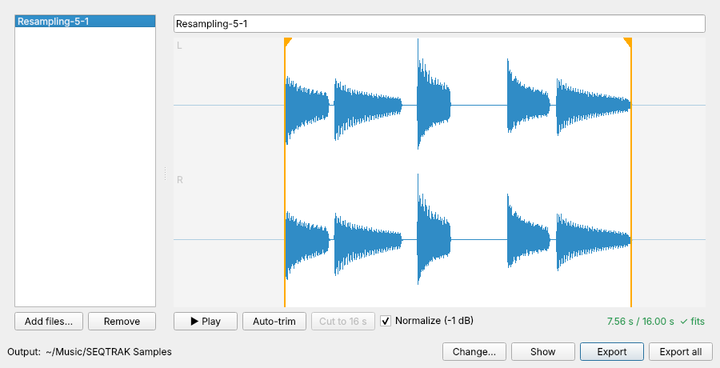

# SEQTRAK Sampler

**Website:** https://rechandler.github.io/seqtrak_sampler/

Companion tools for the Yamaha SEQTRAK. The SEQTRAK app exports resampled sounds
as `.Y3S` files, which it can't import into a synth track. SEQTRAK Sampler (a desktop
app) and `y3s2wav` (its command-line twin) turn them into trimmed stereo WAV files that
it can, without a round trip through a DAW.

It only reads `.Y3S` files; it never writes Yamaha files. The format is described
in [FORMAT.md](FORMAT.md).

## Desktop app



1. In the SEQTRAK app, export the resampled sound (Sound Manager → right-click → Export).
2. Drag the `.Y3S` files into SEQTRAK Sampler (or use **Add files…**).
3. Leading and trailing silence is trimmed automatically. Drag the orange handles to
   fine-tune, press **Play** (or Space) to listen to exactly what will be exported.
4. Name the sample and press **Export**. The WAV lands in the output folder
   (default `~/Music/SEQTRAK Samples`); **Show** opens it.
5. Import the WAV into a synth track in the SEQTRAK app.

### Slice a sample onto pads

Turn on **✂ Slice**, then click the waveform to add cuts (drag to move, right-click to
remove), or use **Auto-detect hits** or **Split into N equal slices**. Click
**Load slices to pads…**, pick a pad for each slice (up to 7), and follow the steps:

1. On the SEQTRAK, select the SAMPLER track, press the pad, then press **REC SAMPLE**.
2. Click **Play into SEQTRAK**. The app switches the SEQTRAK's sampling source to USB audio
   and plays the whole sample into it.
3. Press **REC SAMPLE** again to stop, then click **Next**.

The app then plays the pad back once to find where the sample landed, and trims the pad
to its slice. Every pad holds the whole sample, so you can widen a slice later. Undo puts
a pad back. When it's done, the sampling source is set back to the built-in mic / AUDIO IN.

### Faster round trips

- **Watch folder:** click **Watch folder…** and pick the folder you export `.Y3S` files
  to. New exports load on their own within a second, and re-exporting a sound with the
  same name reloads it (keeping the name you gave it).
- **Drag out:** drag a sample from the list, or the **Drag WAV** button, straight onto
  the SEQTRAK app's import. No file dialogs.
- **Auto-save:** turn it on and every sample is written to the output folder as soon as
  it loads or you edit it. Renaming a sample renames its file.

### Working with a connected SEQTRAK

Plug the SEQTRAK into your computer over USB and the **SEQTRAK** panel in the sidebar
comes alive:

- **Record:** captures the SEQTRAK's USB audio straight into the app. Turn on
  **Rec on Play** to start recording when you press Play on the SEQTRAK and stop when
  you press Stop. A short pre-roll keeps the first hit. No export step, and no 16-second
  limit while recording (you trim to 16 s afterwards).
- **Sampler pads:** the 7 pads of the current project, with their names and lengths.
  Green means the pad is open in the app; orange means it isn't yet. The list refreshes
  every few seconds while the app is in front, so a new resample shows up on its own.
- **Trim a pad:** click an orange pad. The SEQTRAK plays it once while the app records
  it, and it opens in the editor. Drag the handles, listen, then click **Apply to pad N**
  to set the pad's start and end points on the device. You can shorten what the pad
  plays but not extend it past its current start or end, and the recording includes the
  pad's effects. Silence at the start of a pad is shown, so you can trim it away; the trim lines up with the device to within a few milliseconds.
  `.Y3S` files exported from a pad can be applied back to it the same way.
- **Undo / Reload:** **Undo** puts the pad back the way it was before the last Apply,
  one step at a time, back to how it was before the app first changed it (the history is
  kept between launches). **Reload** reads the pad from the SEQTRAK again and reopens it,
  e.g. after you've changed it on the device. Trimming never deletes audio: the pad keeps
  its whole recording, so nothing is lost.

Reading pads and applying trims uses MIDI System Exclusive messages from Yamaha's
[SEQTRAK Data List](https://data.yamaha.com/files/download/other_assets/5/2226075/SEQTRAK_data_list_En_D0.pdf). Two things to know:

- The SEQTRAK answers SysEx only when its *USB MIDI Transmit System Exclusive* setting
  is on, and it's off by default. If the panel says SysEx is off, click **Enable**.
- On Windows only one app can use the SEQTRAK's MIDI port at a time, so close the
  SEQTRAK app while you use the panel and **Rec on Play**. The **Record** button works
  either way, since it only needs the audio connection.

The SEQTRAK's MIDI interface doesn't carry audio, so samples still reach a synth track
through the SEQTRAK app's WAV import.

The length meter shows the selection against the SEQTRAK's 16-second limit. Anything
past the limit is shaded red and Export is disabled until you drag the end handle in
or press **Cut to 16 s**. Edges that cut through sound get a short fade so they don't
click. **Normalize** raises the peak to -1 dBFS.

### Getting the app

Download the latest build from the [website](https://rechandler.github.io/seqtrak_sampler/#download)
or the [Releases page](https://github.com/rechandler/seqtrak_sampler/releases/latest).
Every push also builds macOS and Windows apps (Actions → Build → Artifacts); pushing a
`v*` tag publishes them as a Release. They aren't code-signed: on macOS, right-click the app
and choose **Open** the first time; on Windows, choose **More info → Run anyway**.

To run from source instead:

```
pip install ".[gui]"
seqtrak-sampler
```

## Command line

Python 3.9+, no other dependencies.

```
pip install .
```

```
y3s2wav Resampling-5-1.Y3S                # writes Resampling-5-1.wav next to it
y3s2wav *.Y3S -o converted/               # batch into a folder
y3s2wav take.Y3S --normalize              # peak-normalize to -1 dBFS
```

Output is always 44.1 kHz, 16-bit stereo (mono sounds are duplicated to both sides).
Leading and trailing silence below -60 dBFS is trimmed (`--threshold-db`, `--pad-ms`,
`--no-trim`).

The SEQTRAK caps samples at 16 seconds. Longer results are refused unless you pass
`--truncate`, which cuts to 16 s with a 10 ms fade-out.

## Development

```
PYTHONPATH=src python3 -m unittest discover -s tests
PYTHONPATH=src python3 -m seqtrak_sampler.gui     # run the app from a checkout

# Build the app locally (on the OS you're targeting)
pip install pyinstaller ".[gui]"
pyinstaller --noconfirm --windowed --name "SEQTRAK Sampler" packaging/launch.py
```
